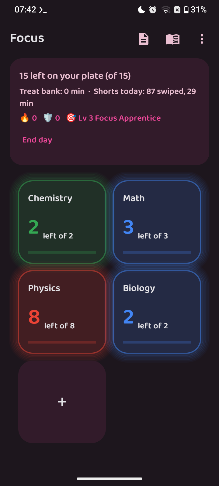
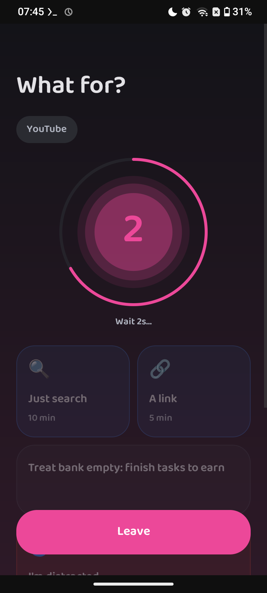
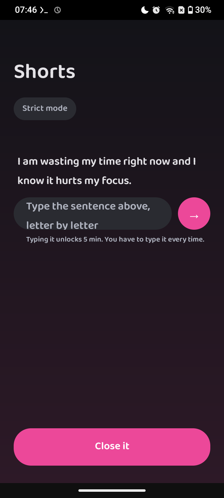
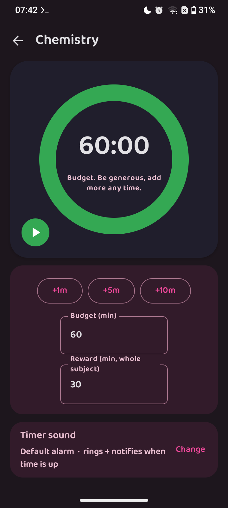
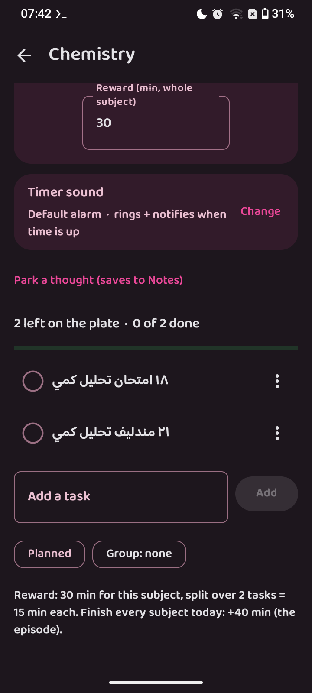
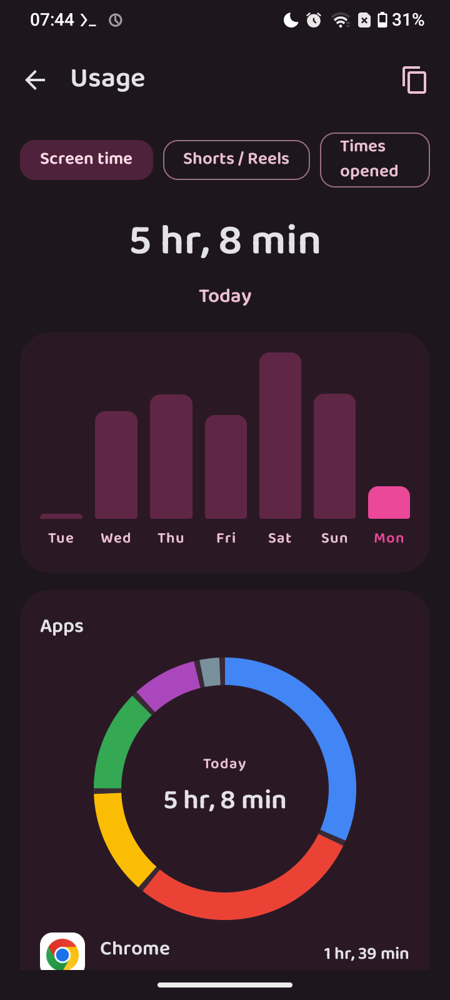
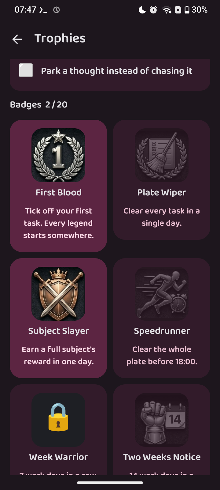
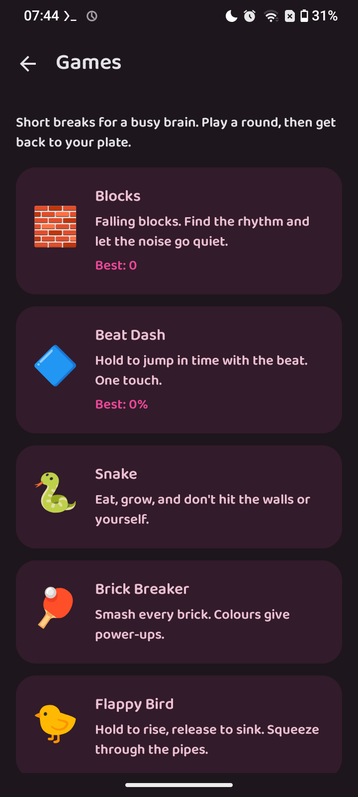

<div align="center">

# Focus Study Gate

**Study on purpose. Use your phone on purpose.**

A private, open-source Android app that turns your study plan into a reward system and puts a soft gate in front of the apps that eat your time.

[](#install)
[](LICENSE)
[](#install)
[](PRIVACY.md)
[](#tech-stack)

**English** · [العربية](README.ar.md)

[Features](#features) · [How it works](#how-it-works) · [Install](#install) · [Permissions](#permissions) · [Documentation](#documentation) · [Contributing](CONTRIBUTING.md) · [Changelog](CHANGELOG.md)

</div>

---

## Screenshots

<p align="center">
  
  
  
  
</p>
<p align="center">
  
  
  
  
</p>

## What is Focus?

Focus Study Gate (package `com.barq.focus`, called just "Focus" inside the app) is built on one idea: **finish your work first, then spend what you earned.**

You split your day into subjects with task lists and generous timers. Each subject carries a reward, and finishing tasks fills a daily **treat bank** of minutes. You spend those minutes at the **gate** in front of distracting apps, on Shorts/Reels, or on the built-in player. When the bank is empty, the gate offers short free passes behind a countdown, or lets you leave.

Everything runs on your phone. There is no account, no server, and the manifest declares no internet permission.

## Features

### Study and rewards

| | |
|---|---|
| **Subjects and tasks** | Per-subject checklists with a pausable, extendable timer, an alarm with sound, and spoken reminders when you run over. Long-press a card to edit, delete or change its media. |
| **Treat bank** | Each subject's reward is split across its tasks and paid out as you tick them off. The bank resets daily. See [Treat bank](docs/architecture/treat-bank.md). |
| **Weekly tasks** | Do them any day. The sooner you finish, the bigger the multiplier (x2 down to x1, then x0.5 once late). |
| **Parked thoughts** | Capture a distracting idea straight into Notes without leaving the subject. |
| **Events and meetings** | Reminders with three urgency levels; high-priority ones ring until you answer. |

### Phone control

| | |
|---|---|
| **Soft gate** | Choose which tracked apps (YouTube, Chrome, YouTube Music, VLC, Telegram) get the gate. Opening one shows a "what for?" overlay with a short countdown and a choice of passes. See [Gate and watcher](docs/architecture/gate-and-watcher.md). |
| **Not-free blocks** | Scheduled time windows where only an allow-list of apps works. Optional strict mode removes the emergency override. |
| **Shorts / Reels counting** | Detects YouTube Shorts, Instagram Reels and TikTok, counts swipes, and lets you leave. See [Shorts detection](docs/architecture/shorts-detection.md). |
| **Safe leave** | **Leave** presses Back to exit most apps, but sends browsers Home so your tabs and history are kept. |
| **Strict Shorts mode** | Optional. The gate opens at once, with no "finish this one", and the only way on is a sentence you type by hand (paste is blocked). Can gray the screen while a feed is open. |
| **Usage screen** | Digital Wellbeing-style screen time for every app: week chart, donut, per-app list, hourly strip and a day-by-day history. See [Usage screen](docs/guides/usage-screen.md). |

### Notes, reading and media

- **Notes** with text, checklists, rich formatting (H1-H3, bold, italic, underline, strikethrough, colours), labels, pin, archive, trash, search, backup voice notes, and attachments (photos, videos, any file, links, linked notes) that you can drag to rearrange. See [Notes and PDF](docs/architecture/notes-and-pdf.md) and [Attachments](docs/guides/attachments.md).
- **PDF library and reader**, built in, or hand-off to Episteme Reader if you have it installed.
- **Embedded player** for treat videos, **treat series** with one token per episode and optional file locking ([Treat series](docs/guides/treat-series.md)), a **first-run guide**, and a **music player** with folders, artists, playlists, favourites, queue, A-B repeat, speed/pitch, sleep timer and equalizer. Playing audio shows a media notification that phone-maker capsules (Realme Mini Capsule, Samsung Now Bar, Xiaomi Dynamic Island, Pixel) pick up: see [Music notification](docs/guides/music-notification.md).

### Motivation

- Streaks, XP and levels.
- 42 badges, including 13 hidden "Hall of Shame" ones. See [Badges and XP](docs/guides/badges.md).
- 17 short games for breaks. See [Games](docs/guides/games.md).
- Four home-screen widgets: **Treat bank**, **Streak**, **Shorts**, and **Today** with a block per subject. See [Widgets](docs/guides/widgets.md).

### Files and languages

- **`.foc` / `.fcs` files**: one container, and the file header decides what it is (video/audio, PDF, or JSON for your day, config, notes or a language pack). See [.foc file format](docs/architecture/foc-files.md).
- **Plan with any AI**: share its JSON reply straight into Focus.
- **English, Arabic** (full right-to-left), **Russian, German and French** built in, plus importable language packs. See [Languages](docs/architecture/i18n.md).

## How it works

```
WatchService (foreground, polls UsageStats every second)
  -> learns the foreground app
  -> logs time per tracked app and background music
  -> app is gated?   -> Overlay: "what for?" + free pass / spend treat / "I'm distracted" / leave
  -> inside a block? -> only allow-listed apps pass
FocusAccessibility (YouTube, Instagram, TikTok only)
  -> ShortsDetector decides "is this a short-form feed?"
  -> swipe counted (the page settles, then the video must really have changed)
Usage screen -> SysUsage (system usage events) when allowed, else Db
Widgets -> FocusWidgets.refresh(), called from the watcher loop
Store (preferences) + Db (usage log) + NotesDb
  -> everything local, nothing leaves the device
```

The full picture is in [Architecture overview](docs/architecture/overview.md).

## Install

> Focus is currently a **beta** (`0.25.0-beta`, version code 42). Requires **Android 8.0 (API 26)** or newer.

### Build from source

```bash
git clone <your-repository-url> focus
cd focus
# Android SDK required; local.properties must contain sdk.dir
gradle assembleDebug
# APK: app/build/outputs/apk/debug/app-debug.apk
adb install -r app/build/outputs/apk/debug/app-debug.apk
```

Requirements: JDK 17, Android SDK platform 34, Gradle 8.7. Termux and CI notes are in the [Building guide](docs/guides/building.md).

### First run

Focus guides you through three grants on the home screen ("Setup needed"): **Usage access**, **Display over other apps** and, for Shorts counting, the **Accessibility service**. Then set **Battery > Unrestricted** so your ROM does not kill the watcher. Details in [Setup guide](docs/guides/setup.md).

## Permissions

| Permission | Why Focus needs it |
|---|---|
| Usage access (`PACKAGE_USAGE_STATS`) | Learn which app is in the foreground, log time per app, and draw the Usage screen. |
| Display over other apps (`SYSTEM_ALERT_WINDOW`) | Draw the gate overlay on top of gated apps. |
| Accessibility service | Only for YouTube, Instagram and TikTok: detect Shorts/Reels, count swipes, close the app when you pick Leave. |
| Notification listener | Only to read active media sessions, so background music can be logged. |
| Notifications, foreground service, boot, wake lock | Run the watcher, timers and reminders reliably. |
| Microphone (`RECORD_AUDIO`) | Voice notes, only when you press record. |
| Audio / storage read | The music player. |
| Kill background processes | Close leftovers when you choose Leave. |

**There is no internet permission.** Every permission is explained in [Permissions](docs/guides/permissions.md) and the [privacy policy](PRIVACY.md).

## Tech stack

- Kotlin 1.9.24, Jetpack Compose (BOM 2024.06.00), Material 3
- AndroidX Media3 1.3.1 (ExoPlayer, UI, MediaSession)
- Android `PdfRenderer` for the built-in PDF reader
- Local storage only: preferences, SQLite, private files
- Android Gradle Plugin 8.5.2, JDK 17, min SDK 26, target SDK 34
- GitHub Actions builds a debug APK on every push and pull request

## Project layout

```
app/src/main/java/com/barq/focus/
  data/      Store, Db, NotesDb, Usage (system screen time), Foc (file formats), I18n, Game (XP, badges), Events, Music, Apps
  service/   WatchService, Overlay, FocusAccessibility, ShortsDetector,
             Reminders, Alerts, Notifier, Music, Widgets, boot
  ui/        Compose screens: Home, Subject, Timer, Notes, Pdf, Music, Games, Trophies, Log (Usage), Setup, Import
  ui/theme/  Colour, type, theme
docs/        Architecture and guides (start at docs/README.md)
```

## Documentation

| Topic | Page |
|---|---|
| Index of all docs | [docs/README.md](docs/README.md) |
| Architecture overview | [docs/architecture/overview.md](docs/architecture/overview.md) |
| Gate and watcher | [docs/architecture/gate-and-watcher.md](docs/architecture/gate-and-watcher.md) |
| Shorts/Reels detection | [docs/architecture/shorts-detection.md](docs/architecture/shorts-detection.md) |
| Treat bank | [docs/architecture/treat-bank.md](docs/architecture/treat-bank.md) |
| `.foc` file format | [docs/architecture/foc-files.md](docs/architecture/foc-files.md) |
| Languages and RTL | [docs/architecture/i18n.md](docs/architecture/i18n.md) |
| Notes, PDF, voice | [docs/architecture/notes-and-pdf.md](docs/architecture/notes-and-pdf.md) |
| Setup guide | [docs/guides/setup.md](docs/guides/setup.md) |
| Permissions | [docs/guides/permissions.md](docs/guides/permissions.md) |
| Building | [docs/guides/building.md](docs/guides/building.md) |
| Badges and XP | [docs/guides/badges.md](docs/guides/badges.md) |
| Projects and the piggy bank | [docs/guides/projects-and-piggy.md](docs/guides/projects-and-piggy.md) |
| Widgets | [docs/guides/widgets.md](docs/guides/widgets.md) |
| Usage screen | [docs/guides/usage-screen.md](docs/guides/usage-screen.md) |
| Games | [docs/guides/games.md](docs/guides/games.md) |
| Privacy policy | [PRIVACY.md](PRIVACY.md) |
| Credits and third-party notices | [THIRD_PARTY_NOTICES.md](THIRD_PARTY_NOTICES.md) |

## Contributing

Issues and pull requests are welcome. Short-form detection depends on YouTube, Instagram and TikTok screen IDs that change without notice, so reports with captured IDs are especially useful. See [CONTRIBUTING.md](CONTRIBUTING.md).

## License

Focus is free software under the **GNU Affero General Public License v3.0 only** (`AGPL-3.0-only`). See [LICENSE](LICENSE). Every source file carries the header in [docs/LICENSE_HEADER.txt](docs/LICENSE_HEADER.txt).

## Credits

The notes module follows the feature set of [NotallyX](https://github.com/Crustack/NotallyX) (forked from [Notally](https://github.com/OmGodse/Notally)); PDFs can be opened in [Episteme Reader](https://github.com/Aryan-Raj3112/episteme), a separate app that is not bundled; the Shorts detector and gate screen follow [Nudge](https://github.com/astraedus/nudge); game ideas come from [formulas-games](https://github.com/GuillaumeFalourd/formulas-games). The code in this repository is an independent implementation. Full details: [THIRD_PARTY_NOTICES.md](THIRD_PARTY_NOTICES.md).
